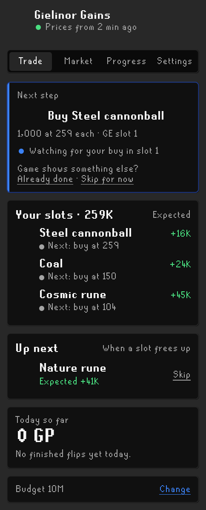
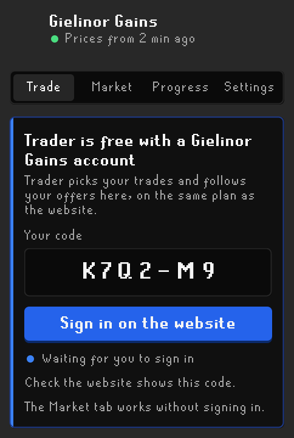
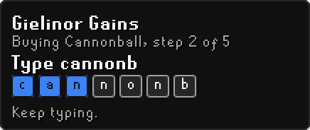
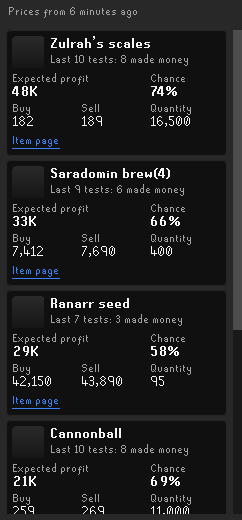
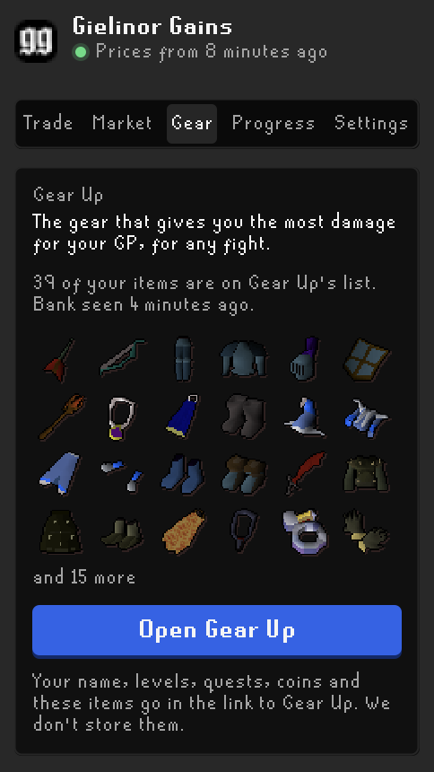
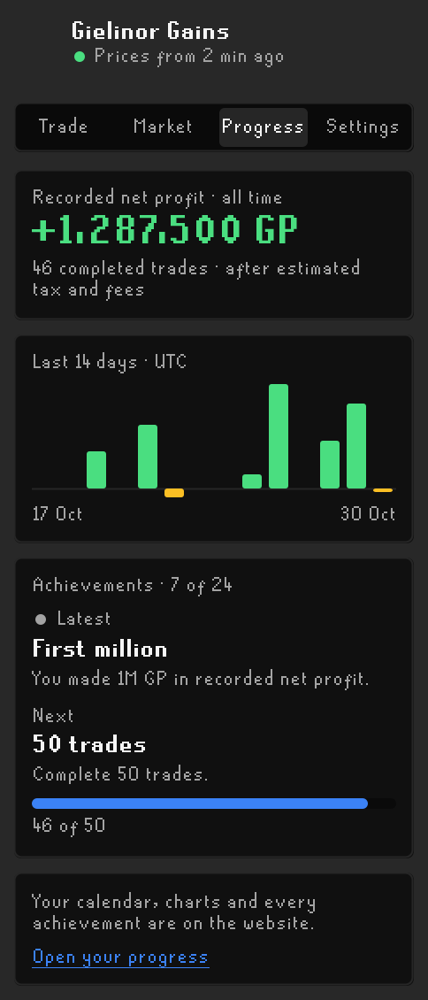
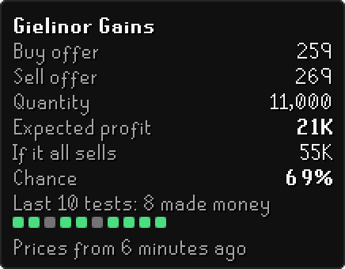
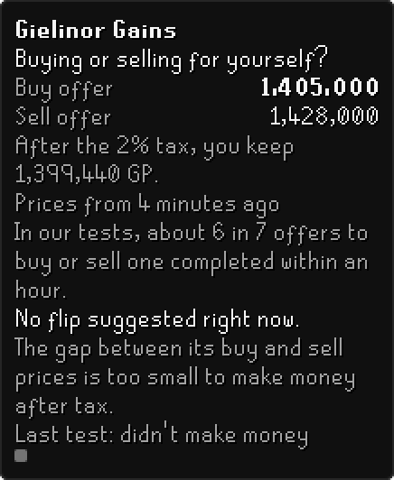

# Gielinor Gains

Gielinor Gains helps you trade on the Grand Exchange. This plugin brings it into RuneLite:

- **Trader** picks trades for your budget and walks you through each one at the GE.
- **Market** shows today's flips, highest expected profit first.
- **Gear** opens the website's Gear Up with the gear you own, so it plans with what you have.
- **Progress** shows your profit and achievements.
- **The GE box** shows our numbers for any item you set up an offer for.

It's all free. Trader needs a free Gielinor Gains account. The Market, Gear and the GE box need no
account. There are no ads and nothing to buy.

It never clicks or types for you. It outlines what to click and tells you what to type. You make
every click and press every key yourself.

## Install

1. Open RuneLite and click the wrench icon to open Configuration.
2. Click **Plugin Hub** at the bottom.
3. Search for **Gielinor Gains** and click **Install**.
4. Click the Gielinor Gains button in the sidebar.

## Trade

Trader is the same Trader as on [gielinorgains.com](https://www.gielinorgains.com/trader). It uses
the same account and the same plan. A change on the website shows here, and the other way round.

### Sign in

Open the Trade tab. It shows a short code.

1. Click **Sign in on the website**.
2. Sign in, type the code, and click **Link RuneLite**.
3. Go back to RuneLite. The Trade tab signs in by itself.

Your password never goes into RuneLite. To sign out, click **Unlink** on the Settings tab. Unlink on
your Account page on the website signs out every RuneLite at once.

### Trade with the plan

1. Type how much GP you want to trade with. If you open your bank, Trader suggests your coins.
2. Trader fills your GE slots with trades that fit that budget.
3. The **Next step** card says what to do now, like "Buy Steel cannonball".
4. At the GE, the next thing to click has an outline.
5. When you set a quantity or price, the box shows the fewest keys to type, like 11k for 11,000.
6. Trader follows your offers. It tells you when to collect and when to sell.

To find the item in the GE search, the box shows the fewest letters that bring it up.

Each slot shows its next step and its expected profit after the 2% tax. When a slot frees up, Trader
picks the next trade. **Up next** shows what that will be. **Today so far** adds up your profit.

If the game shows something else, use **Already done** or **Skip for now**. If a sale hasn't moved
for 8 hours, Trader suggests a lower price. It guides you through Modify to change it. If the price
drops while you buy and no profit is left, Trader tells you to cancel the rest. You can **Keep
buying** if you'd rather wait.

A **Rebound** is an item that just dropped in price and fits our tested plan. When one is fresh, it
shows above your slots. Click **Add to plan** to trade it, or **Not now**.

## Market

The Market tab lists today's flips from the free Market. Each one shows:

- expected profit after tax, and Chance: how often trades like this made money within 4 hours;
- our buy and sell prices, and how many to buy;
- the item's track record, misses included ("Last 10 tests: 7 made money").

Click a flip to have the GE box guide you through it. If you're signed in, **Add to Trader** puts it in
your plan. **Item page** opens its page on the website.

On a free world, members' items are hidden, and the list says so.

## Gear

Gear Up on our website shows the gear that gives you the most damage for your GP, for any fight. The
Gear tab opens it with your gear, levels, quests and prayer unlocks. Items you own cost nothing there,
and it tells you if your coins cover the setup. You don't have to type or tick anything.

The tab reads your worn gear and bag, and your bank when you open it. It keeps only the items on Gear
Up's list. It shows how many it found and when it last saw your bank. Press Open Gear Up to open it in
your browser.

## Progress

The Progress tab shows your recorded net profit, after estimated tax and fees. It also shows your last
14 days and your achievements. When you earn one, a game message tells you. Your calendar and every
achievement are on the website.

## The GE box

When you set up an offer, a small box beside the GE shows our numbers for that item. Hover over it to
see what each number means. Shift+right-click it to open the item's page.

If we don't suggest the item, the box says why. It also shows the website's offers for buying or selling
it for yourself, and how often offers like that filled in our tests.

The numbers are estimates, not promises. If our prices are late or can't be reached, the box says so
instead of showing old numbers.

## Notifications and sounds

You get a RuneLite notification when a buy fills, when it sells, and when Trader has a new step for
you. It follows your RuneLite notification settings. You can also turn on a sound: the game's own GE
sound, at your sound effect volume. The sound is off unless you turn it on.

## Settings

The Settings tab has your account, Unlink and your budget. The rest are in RuneLite's settings:

| Setting                  | Default | What it does                                                                  |
| ------------------------ | ------- | ----------------------------------------------------------------------------- |
| Show the sidebar button  | On      | The Gielinor Gains button. Off removes it and stops the Market's downloads.   |
| Guide my GE offer        | On      | Outlines what to click at the GE and shows what to type.                      |
| Highlight color          | Blue    | The color of the outline.                                                     |
| Notify me                | On      | A RuneLite notification when a buy fills, it sells, or Trader needs you.      |
| Sound when it fills or sells | Off | The game's own GE sound.                                                     |
| Show when buying         | On      | The box when you set up a buy offer.                                          |
| Show when selling        | On      | The box when you set up a sell offer.                                         |
| Show offers to collect   | On      | A small box that counts GE offers ready to collect, while you use Trader.     |
| Reduce motion            | Off     | Turns off the sidebar's small moves.                                          |
| Remember my gear for Gear Up | On  | Reads your gear for the Gear tab. Off forgets it.                             |

## What it sends

This plugin talks to gielinorgains.com, a third-party server. RuneLite doesn't run or check it. Like
any website, our server sees your IP address and your RuneLite version.

**Without signing in**, it sends nothing about you or your account:

- It downloads one public list of prices for all items, at most once every 5 minutes. It does this only
  while the Market tab is open or you use the GE.
- When you set up an offer for an item we don't suggest, it asks for that item's price. That tells our
  server which item you looked at.

**If you sign in**, it also sends:

- your GE offers: item, price, quantity, how much filled, and when;
- the buys and sells you finish, for your profit;
- your Trader plan and budget. If you haven't typed a budget, it sends the GP Trader plans with: your
  coins from the bank and bag, up to 20M. Past 20M, it sends 20M, not your real total;
- whether you're on a members world;
- RuneLite's ID for your game account. This is a random ID, not your name;
- which Trader steps you reached each day, like "placed a buy".

It sends these about every 3 minutes while something changes, else every 10 minutes. It also downloads
Trader's public list of picks, about every 5 minutes. It never sends your password or your chat.

**Gear:** the Gear tab downloads Gear Up's public list of items when you open the tab or your bank. That
download carries nothing about you. The tab keeps your Gear Up items and coins in RuneLite's settings and
sends them nowhere itself. When you press Open Gear Up, your browser opens Gear Up with your name,
levels, account type, the quests and unlocks Gear Up asks about, coins and those items in the link,
after the #. Browsers don't send that part to any server, so ours never
gets it. The page keeps it in your browser to plan with. Turn off "Remember my gear for Gear Up" to
forget it here, and press "Forget what RuneLite sent" on Gear Up to forget it there.

Your sign-in key is kept in RuneLite's settings, like your recent trades. If you use RuneLite's profile
sync, they are synced with your profile. The website keeps only a scrambled copy of the key. Unlink ends
the key for good.

On Leagues, Deadman and beta worlds, it downloads nothing. Those worlds have their own prices.

## Free

Trader, the Market, Gear, Progress and the GE box are free. Trader needs a free account. Nothing is for sale.

## License

BSD 2-Clause. See [LICENSE](LICENSE).
